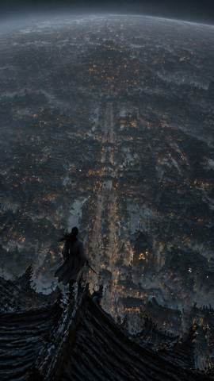
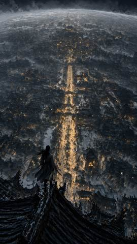
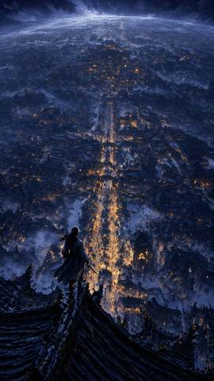
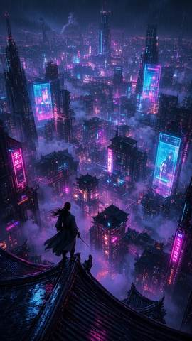
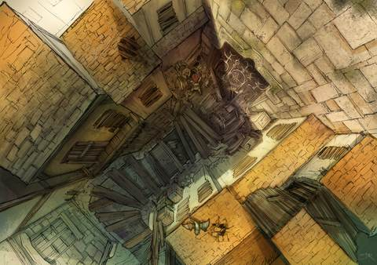
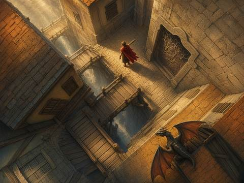
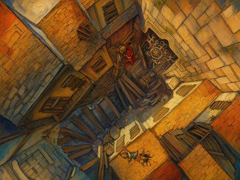
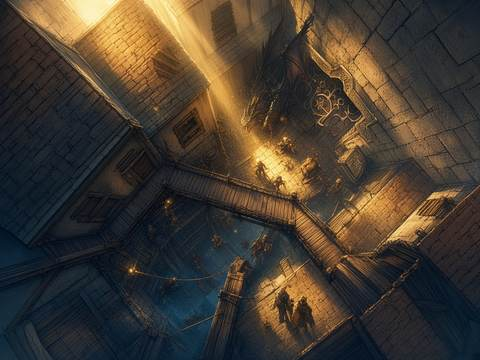
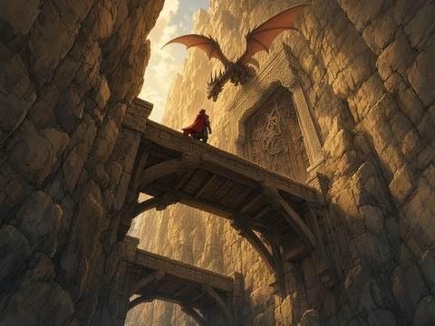
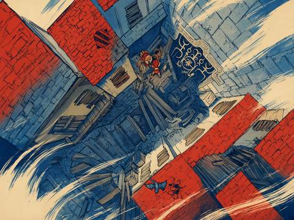

<div align="center">

# 项目 → 记忆 → 可复现资产

**pmem-art** · 插拔式、托管式的 **AI 美术记忆系统**  
（其次才是自带的斜杠 Skill 闭环）

把主美红线、色板锚点、管线硬指标和过稿配方留在项目里。<br>
Agent 生图前自动查、对话里随口一句话就记下来；记忆随仓库走，换机器还能用。

**主线是记忆；Skill 是把记忆用起来的加速器。**


[📖 使用手册](USER_MANUAL.md) · [快速接入](#如何接入约-1-分钟) · [优势](#为什么是-pmem-art) · [记忆怎么用](#如何使用记忆为主--skill-为辅) · [四档闸门](#四档闸门每档允许变什么--禁止变什么) · [效果](#效果长什么样) · [架构](ARCHITECTURE.md)

</div>

---

## 解决什么问题

AI 美术每个对话几乎从零开始：上周主美打回的霓虹色、九宫格中心不能画花纹、某张过稿图的 Prompt / 色板 / 头身比，下一次它全不知道。结果是同样风格跑偏反复发生，管线硬指标（RGBA、切图、安全边）一改就炸，好配方散落在聊天记录里无法复现。

**pmem-art 先解决「记不住」**：把结论按美术模块（`brand.*` / `character.*` / `scene.*` / `ui.*` / `vfx.*`）沉淀进 `.memory-art/`。生图前 `search` 召回；一句「太赛博 / 这版留着」即入库。  
**再提供「用得顺」的内置 Skills**（可选）：`/pmem-draw` 等在召回记忆之上做 **生图 → 独立审图 → `< 9.60` 继续修** 的闭环。不用 Skill、只用 `search` / `feedback` / `ingest`，记忆系统照样工作。

| 层级 | 你得到什么 |
| :--- | :--- |
| **① 核心 · 美术记忆** | 红线 / 定稿 / 色板 / 管线 specs / recipe；模块继承；本地可提交；`doctor` / `validate` / `art-atlas` |
| **② 加速 · 内置 Skills** | 11 组斜杠技能（draw / concept / ui / icon…）+ 四档 `scale` 闸门 + ≥9.60 收敛；安装后对话框 `/` 即用 |

| 特性 | 说明 |
| :--- | :--- |
| 🎨 **视觉记忆，不是聊天日志** | 正反例图、HEX 色板、分辨率 / RGBA / 九宫格等 **可校验契约**；按模块继承，不是只能全文搜的笔记 |
| 🗣️ **自然语言即可沉淀** | 「太赛博 / 头太大 / 这版留着 / 换成水彩」→ `feedback` 自动归类红线 / recipe / 勘误 / 拍板 |
| 🔎 **生图前强制可召回** | `search --module` / Warm-Start：把历史红线与定稿配方注进下一轮 Prompt |
| 📉 **越用越收敛** | 静默写反思与口味档案；同一错少犯第二次；跨项目可挂共享知识卡 |
| 🗂️ **本地资产，可进版本库** | 记忆在 `.memory-art/`；可选图谱 `art-atlas.html`；不上传服务器 |
| ⚡ **（其次）内置 Skill 闭环** | `skills --install` 后可用 `/pmem-draw` 等；generate / judge 分步，≥9.60 停机；闸门不合可用提示词覆盖 |

相对代码版 [**pmem**](https://github.com/mry-ship/pmem)（记根因 / 排除项 / 模块契约）：同一套「查 → 干 → 记」习惯；**pmem-art** 换成美术语义（风格漂移、管线硬指标、可复现配方）。详见 [ARCHITECTURE.md](ARCHITECTURE.md)。

---

## 为什么是 pmem-art

| 维度 | 常见做法 | pmem-art（记忆优先） |
| :--- | :--- | :--- |
| 风格一致性 | 每次手写 Negative / 口头叮嘱 | 模块级 `style_redline` + 色板 + 父模块继承，生图前自动召回 |
| 过稿复现 | 聊天记录里翻旧图 | `recipe` / `art_decision` 定稿锚点；`feedback "这版留着"` 一句话入库 |
| 管线返工 | 进引擎才发现漏透明 / 切图炸 | 模块 `specs` + `validate` / `doctor`（分辨率、RGBA、九宫格…） |
| 知识归属 | 散落在个人笔记 / Discord | `.memory-art/` 按 `character.*` / `ui.*` 等模块落盘，可随 git 共享 |
| Agent 对齐 | 每人一份提示词 | 记忆是单一事实源；Skill 只是消费记忆的官方工作流 |
| （可选）出图质量 | 单次抽卡、主观「还行」 | 内置 Skill：五维加权 + 物理闸门，**≥ 9.60** 动态停机；四档 `scale` 锁改动幅度 |

---

## 如何接入（约 1 分钟）

```bash
git clone https://github.com/mry-ship/pmem-art.git
cd pmem-art
python3 pmem_art.py init --name "MyArtProject"   # 核心：初始化美术记忆库
python3 pmem_art.py skills --install             # 可选：安装内置斜杠 Skills
```

只做记忆、暂不装 Skill 也可以：日常用 `search` / `feedback` / `ingest` 即可。装上 Skill 后，在 Cursor / Claude Code / Codex 对话框输入 `/` 可唤出 `/pmem-draw` 等。

| 场景 | 命令 |
| :--- | :--- |
| 空项目 | `init` →（可选）`skills --install` |
| 已有美术目录（不乱移文件） | `bootstrap --mode legacy --roots Art assets` → `accept --all` →（可选）`skills --install` |
| 只刷新 Skills | `python3 pmem_art.py skills --install` |

更细的三种接入方式见手册 [第四章](USER_MANUAL.md#第四章三种项目接入方式空项目--老项目--持续生图)。

---

## 如何使用（记忆为主 · Skill 为辅）

### A. 记忆主路径（随时可用，不必开 Skill）

```bash
# 生图前：召回该模块红线 / 定稿 / 色板
python3 pmem_art.py search --module character.Astra

# 画师随口评价 → 自动沉淀
python3 pmem_art.py feedback "太赛博了，别这样画" -m character.Astra
python3 pmem_art.py feedback "这版留着" -m character.Astra -a path/to/keep.png

# 新图入库（分类 + 归位，默认 dry-run）
python3 pmem_art.py ingest path/to.png -p "Astra 立绘 青瓷" --apply
```

### B. 内置 Skill 加速路径（可选）

在已安装 Skills 的对话框里：

```text
1. 丢图（可选）  把参考图拖进对话
2. 选档          --scale low | medium | high | recompose
3. 出图          Agent：converge start → generate → judge → finish（写回记忆）
```

```text
/pmem-draw --scale low [拖入参考图] 只修五指与透视，不改构图
/pmem-draw --scale medium [拖入参考图] 保持构图，补侧逆光与材质
/pmem-concept --scale high [拖入参考图] 锁画风与身份，升级戏剧光影
/pmem-draw --scale recompose --recompose-dir "改为运河石拱桥仰视" [拖入参考图]
```

### 四档闸门：每档「允许变什么 / 禁止变什么」

四档是 **技能闸门**（写进 `converge start --scale`，审图也会按此约束）。  
选错档时：**不必改代码**——在对话里用自然语言加提示词，就能在该档闸门内加严或放宽（见下一节）。

| 档位 | Prompt 改动上限 | ✅ 允许变 | 🚫 禁止变（闸门） | 五维权重侧重 |
| :--- | :--- | :--- | :--- | :--- |
| **`low`** 保守修瑕 | ≤ **20%**（相对首轮） | 局部瑕疵：五指/透视毛刺、瓦片笔触、边缘小修 | **机位 · 姿态 · 主体数量 · 场景布局 · 画风媒介 · 身份**（性别/物种/年龄段/核心外观） | 透视 25% · 质感 25% · 光影 20% · 构图 15% · 风格 15% |
| **`medium`** 标准补足（默认） | **25%–45%** 上轮 · 累计 ≤ **60%** | 在原构图内 **补光影与材质**（可加强轮廓光/空气感；`allow_lighting_overhaul=是`） | **机位 · 姿态 · 主体数量 · 布局重排 · 画风媒介 · 身份** | 光影 30% · 透视/质感各 20% · 构图/风格各 15% |
| **`high`** 戏剧升级 | **50%–80%** / ≤ **70%** 上轮 · 累计 ≤ **85%** · **≥2 轮才停** | **机位、姿态、布局、电影级冷暖戏剧光影**；张力升级 | **画风媒介基因 · 身份 · 不引入原图没有的外来主体道具**（勿叠构图 DNA / 垫图一致性） | 光影 30% · 质感/风格各 20% · 构图/透视各 15% |
| **`recompose`** 定向改构图 | ≤ **85%** 上轮 · 累计 ≤ **95%** · **≥2 轮才停** | **必须**按 `--recompose-dir` 换机位/布局；可改姿态与光影 | **画风笔触色板 · 身份 · 不得偏离改构图方向**（垫图不继承原机位） | 构图 30% · 透视/光影各 20% · 质感/风格各 15% |

> 统一停机线：**加权分 ≥ 9.60**（`high`/`recompose` 另要求至少 2 轮）。源码闸门见 [`skills_kit/prompt_scale.py`](skills_kit/prompt_scale.py)。**最优方向按档分流**（加法指令，不是第二份锁）。出图前自检：`python3 pmem_art.py check-scale-gates --self-check`。

### 档位不合口味时：用提示词自己调闸门

默认四档是「工厂预设」。若某一档 **太死** 或 **太放**，在同一 `--scale` 下直接加约束句即可（Agent 会并入 Prompt / `next_fix`）：

| 你的感觉 | 怎么说（示例） |
| :--- | :--- |
| `low` 修太少 | 「在 low 闸门内允许微调衣褶高光，仍禁止改机位与姿态」 |
| `medium` 光影仍不够 | 「medium：允许更大冷暖对比与体积光，仍禁止换镜头机位」 |
| `medium` 却想动一点姿态 | 「升级到 high」或「medium 例外：仅允许右手抬高 10°，其余姿态锁定」 |
| `high` 改得太狠 | 「high：禁止改机位，只升级光影与氛围」← 等于把 high 的机位闸门手动关掉 |
| `recompose` 跑偏 | 写清 `--recompose-dir`，并加「必须保留原图 X 元素；禁止换成 Y」 |
| 想永久记住 | `feedback "以后 medium 都禁止改发色"` / `feedback "high 允许侧机位但不许换服装"` |

```text
# 例：嫌 medium 默认太保守 → 同档加提示词加严光影、仍锁机位
/pmem-draw --scale medium [参考图] 保持俯瞰与角色身份；允许强化体积光与雾层；禁止改机位与姿态

# 例：嫌 high 乱动构图 → 同档用提示词收回机位权
/pmem-concept --scale high [参考图] 锁死原图机位与布局，只升级戏剧光影与材质对比

# 例：recompose 方向写死，避免跑偏
/pmem-draw --scale recompose --recompose-dir "改为底层运河石拱桥仰视全景" [参考图] 必须保留持剑孤侠与青黛暖金色板；禁止换成现代都市
```

想改 **默认权重/改动上限**（全局改闸门）：编辑 `skills_kit/prompt_scale.py` 后执行 `python3 pmem_art.py skills --install`。日常更推荐用上面的 **对话提示词** 做单次覆盖。

更细的 CLI / FAQ → [USER_MANUAL 附录 A](USER_MANUAL.md#附录-a四档---scale-细则与示例)。

### 随口一句话也会进记忆

```bash
python3 pmem_art.py feedback "太赛博了，别这样画" -m character.Astra
python3 pmem_art.py feedback "这版留着" -m character.Astra -a path/to/keep.png
```

---

## 效果长什么样

### 自我进化总览（`benchmark-evolution-report`）

跨场景 / UI / 图标等多线收敛时，记忆沉淀与分数爬升长什么样——预览图即报告封面：


本地完整交互报告（含分轮明细）：生成或打开仓库根目录的 `benchmark-evolution-report.html`（由 `benchmark_evolution.py` 产出；体积大，默认不进 git）。

---

### V4 · 20 Bot 冷启动（图墙 + 分数进度）

**设定**：4 案例 × 5 档（`low` / `medium` / `high` / `recompose` / `recompose_bold`）= **20** 空白隔离 Bot；项目私有记忆 = 0；`start → generate → judge`；合格线 **`≥ 9.60`**。  
**结果：`20 / 20` 达标停机。** 每格下方为 **终分 · 轮次 · 分数轨迹**（从 R1 爬到停机）。

全页 HTML 版（可本地放大浏览）：[docs/showcase/pmem_art_images_v4_20bots_showcase.html](docs/showcase/pmem_art_images_v4_20bots_showcase.html)

---

### 案例 01 · 仙侠不夜城（`style_ref_01` · 9:16）

| 📥 原图 | 🤖 low | 🤖 medium | 🤖 high | 🎮 recompose | 🔥 大改 bold |
| :---: | :---: | :---: | :---: | :---: | :---: |
|  |  |  |  |  |  |
| Baseline | **9.71** · 2 轮<br>`R1:9.41 → R2:9.71` | **9.67** · 3 轮<br>`R1:9.34 → R2:9.48 → R3:9.67` | **9.73** · 3 轮<br>`R1:9.23 → R2:9.47 → R3:9.73` | **9.67** · 3 轮<br>`R1:9.30 → R2:9.46 → R3:9.67` | **9.67** · 3 轮<br>`R1:9.30 → R2:9.46 → R3:9.67` |

---

### 案例 02 · 粉彩速写少女（`style_ref_02` · 4:3）

| 📥 原图 | 🤖 low | 🤖 medium | 🤖 high | 🎮 recompose | 🔥 大改 bold |
| :---: | :---: | :---: | :---: | :---: | :---: |
|  |  |  |  |  |  |
| Baseline | **9.71** · 2 轮<br>`R1:9.41 → R2:9.71` | **9.67** · 3 轮<br>`R1:9.34 → R2:9.48 → R3:9.67` | **9.73** · 3 轮<br>`R1:9.23 → R2:9.47 → R3:9.73` | **9.67** · 3 轮<br>`R1:9.30 → R2:9.46 → R3:9.67` | **9.67** · 3 轮<br>`R1:9.30 → R2:9.46 → R3:9.67` |

---

### 案例 03 · 窗边日光胸像（`style_ref_03` · 3:4）

| 📥 原图 | 🤖 low | 🤖 medium | 🤖 high | 🎮 recompose | 🔥 大改 bold |
| :---: | :---: | :---: | :---: | :---: | :---: |
|  |  |  |  |  |  |
| Baseline | **9.71** · 2 轮<br>`R1:9.41 → R2:9.71` | **9.67** · 3 轮<br>`R1:9.34 → R2:9.48 → R3:9.67` | **9.73** · 3 轮<br>`R1:9.23 → R2:9.47 → R3:9.73` | **9.67** · 3 轮<br>`R1:9.30 → R2:9.46 → R3:9.67` | **9.67** · 3 轮<br>`R1:9.30 → R2:9.46 → R3:9.67` |

---

### 案例 04 · 天井峡谷概念（`web_ref_01` · 4:3）

| 📥 原图 | 🤖 low | 🤖 medium | 🤖 high | 🎮 recompose | 🔥 大改 bold |
| :---: | :---: | :---: | :---: | :---: | :---: |
|  |  |  |  |  |  |
| Baseline | **9.71** · 2 轮<br>`R1:9.41 → R2:9.71` | **9.67** · 3 轮<br>`R1:9.34 → R2:9.48 → R3:9.67` | **9.73** · 3 轮<br>`R1:9.23 → R2:9.47 → R3:9.73` | **9.67** · 3 轮<br>`R1:9.30 → R2:9.46 → R3:9.67` | **9.67** · 3 轮<br>`R1:9.30 → R2:9.46 → R3:9.67` |

> 读图提示：横向对比同一案例的档位差异；纵向看分数轨迹如何从 R1 爬到 ≥9.60。大改 `recompose_bold` 为风格跳变实验列（API 仍走 recompose 闸门 + 大幅风格指令）。

---

## 斜杠技能一览（11 主命令 · 11 个别名）

| 想做什么 | 输入 |
| :--- | :--- |
| 通用生图 / 垫图收敛 | `/pmem-draw`（`/art-draw`） |
| 原画 / Key Art | `/pmem-concept`（`/art-concept`） |
| UI Kit / HUD / 九宫格 | `/pmem-ui`（`/art-ui`） |
| App Icon / SVG / 道具图标 | `/pmem-icon`（`/art-icon`） |
| 从样张锁风格色板 | `/pmem-style-lock`（`/art-style`） |
| 审图挑刺写红线 | `/pmem-critique`（`/art-check`） |
| 换画风 / 表情差分 | `/pmem-variant`（`/art-variant`） |
| 归档散图 + 图谱 | `/pmem-atlas`（`/art-map`） |
| 进阶：迭代 / 教练 / 学新卡 | `/pmem-improve` · `/pmem-coach` · `/pmem-learn` |

调用示例与五维说明 → **[USER_MANUAL.md](USER_MANUAL.md)**。

---

## 仓库结构（极简）

```text
pmem_art.py          # CLI 入口
skills_kit/          # 技能定义与 converge 引擎
improve/             # 口味 / 反思 / 双层记忆
.memory-art/         # 本机美术记忆（红线、定稿、会话）
docs/showcase/       # 对外效果页（V4 等）
USER_MANUAL.md       # 完整手册
```

---

## License

见 [LICENSE](LICENSE)。
