<div align="center">

# pmem-art

**给画师用的 AI 生图助手**（Cursor / Claude Code / Codex）

对话框输入 `/` 就能画：丢参考图 → 选改动幅度 → 自动生图审图，不够分就继续修，直到 **≥ 9.60**。  
顺带把你随口说的「别赛博 / 这版留着」记进项目，下次少犯同样的错。


[📖 使用手册](USER_MANUAL.md) · [效果图墙](#效果长什么样) · [Merge / Clone 实测](#merge-ladder--clone-mode-b另外两技能实测) · [架构](ARCHITECTURE.md)

</div>

---

## 一分钟接入

```bash
git clone https://github.com/mry-ship/pmem-art.git
cd pmem-art
python3 pmem_art.py init --name "MyArtProject"
python3 pmem_art.py skills --install
```

装好后，在 Cursor / Claude Code / Codex 对话框输入 `/`，就能看到下面这些技能。

| 场景 | 命令 |
| :--- | :--- |
| 空项目 | `init` → `skills --install` |
| 已有美术目录（不乱移文件） | `bootstrap --mode legacy --roots Art assets` → `accept --all` → `skills --install` |
| 只刷新技能 | `python3 pmem_art.py skills --install` |

---

## 日常怎么用（Skill）

```text
1. 丢图（可选）   把参考图拖进对话
2. 选档           --scale low | medium | high | recompose
3. 出图           Agent 自动：生 1 张 → 打分挑刺 → <9.60 继续修（最多 8 轮）
```

### 复制即用

```text
/pmem-draw --scale low [拖入参考图] 只修五指与透视，不改构图
/pmem-draw --scale medium [拖入参考图] 保持构图，补侧逆光与材质
/pmem-concept --scale high [拖入参考图] 锁画风与身份，升级戏剧光影
/pmem-draw --scale recompose --recompose-dir "改为运河石拱桥仰视" [拖入参考图]
```

### 12 个斜杠技能

| 想做什么 | 输入 | 说明 |
| :--- | :--- | :--- |
| 通用生图 / 垫图修图 | `/pmem-draw`（`/art-draw`） | 最常用；强制 8 轮 ≥9.6 闭环 |
| 原画 / Key Art | `/pmem-concept`（`/art-concept`） | 气氛图、主视觉；同样强制闭环 |
| UI Kit / HUD / 九宫格 | `/pmem-ui`（`/art-ui`） | 概念 → 组件表 → 9-slice → 状态族 |
| App / SVG / 道具图标 | `/pmem-icon`（`/art-icon`） | 桌面图标母版、矢量集、透明底道具 |
| 从样张锁风格 | `/pmem-style-lock`（`/art-style`） | 抽色板 HEX、光影、禁用词 |
| 审图挑刺 | `/pmem-critique`（`/art-check`） | 五维打分，翻车点可记红线 |
| 换画风 / 表情差分 | `/pmem-variant`（`/art-variant`） | 继承角色锚点，派生水彩/Q版等 |
| 散图归位 + 图谱 | `/pmem-atlas`（`/art-map`） | 整理资产，刷新 `art-atlas.html` |
| 同域合并进阶梯 | `/pmem-merge-ladder`（`/art-merge`） | 八件各一张正方形，两两相合；先定关系再抬美术 |
| 风格克隆新主体 | 无斜杠技能 | 下方图墙是早前实验记录，仓库里没有 `/pmem-clone-image` |
| 进阶 | `/pmem-improve` · `/pmem-coach` · `/pmem-learn` | 口味迭代 / 练习计划 / 补知识 |

### 四档改动幅度（选错了用嘴改就行）

| 档位 | 大致在干什么 | 默认锁住什么 |
| :--- | :--- | :--- |
| **`low`** | 修瑕：手、透视毛刺、小边缘 | 机位、姿态、布局、画风、身份 |
| **`medium`**（默认） | 构图不动，补光影与材质 | 同上；允许加强轮廓光 / 空气感 |
| **`high`** | 可以换机位、姿态、戏剧光影 | 画风基因、身份；别塞原图没有的道具 |
| **`recompose`** | 按你写的方向改构图 | 色板笔触、身份；方向写进 `--recompose-dir` |

停机线统一：**≥ 9.60**（`high` / `recompose` 至少跑 2 轮）。  
嫌某档太死或太放：同档直接加一句话，例如「medium：允许更大冷暖对比，仍禁止换机位」。细则 → [手册附录 A](USER_MANUAL.md#附录-a四档---scale-细则与示例)。

---

## 效果长什么样

### 自我进化总览


### V8 · 20 Bot（skills_kit · Absolute-5D）

4 案例 ×（原画 / low / medium / high / recompose / 大改）= **20 终图**；停分 ≥9.60、最多 8 轮。  
本批均值 **9.14**（≥9.60 达标 **4/20**）。全页：[docs/showcase/pmem_art_images_v8_20bots_showcase.html](docs/showcase/pmem_art_images_v8_20bots_showcase.html)

#### 案例 01 · 仙侠不夜城

| 📥 原图 | 🤖 low | 🤖 medium | 🤖 high | 🎮 recompose | 🔥 大改 |
| :---: | :---: | :---: | :---: | :---: | :---: |
|  | 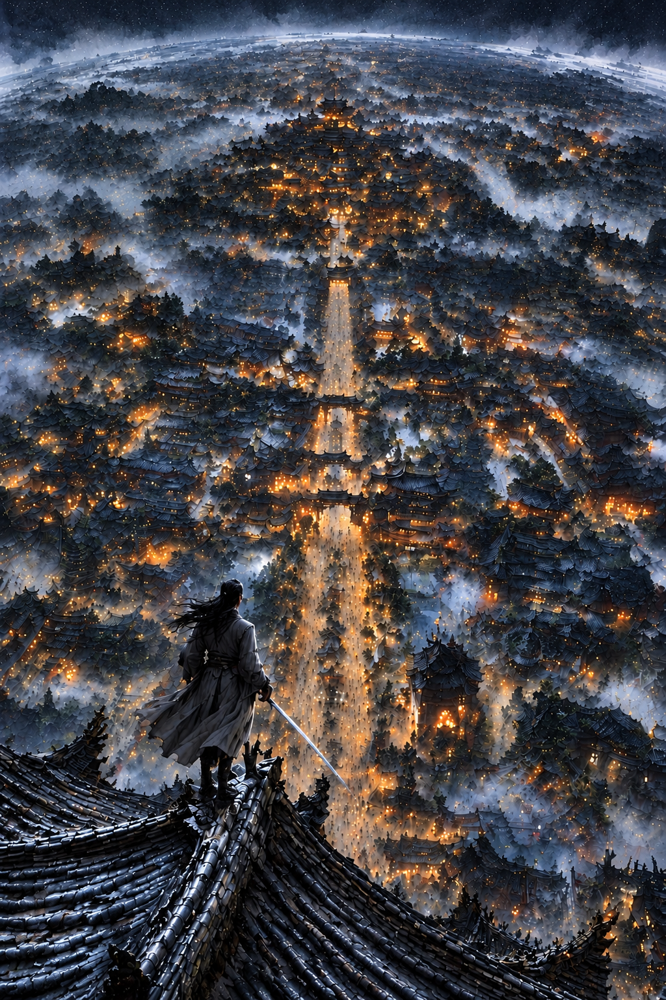 | 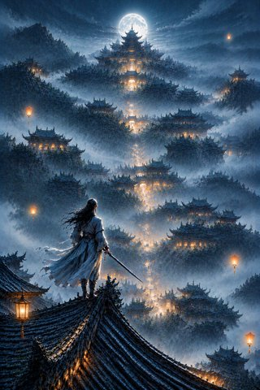 | 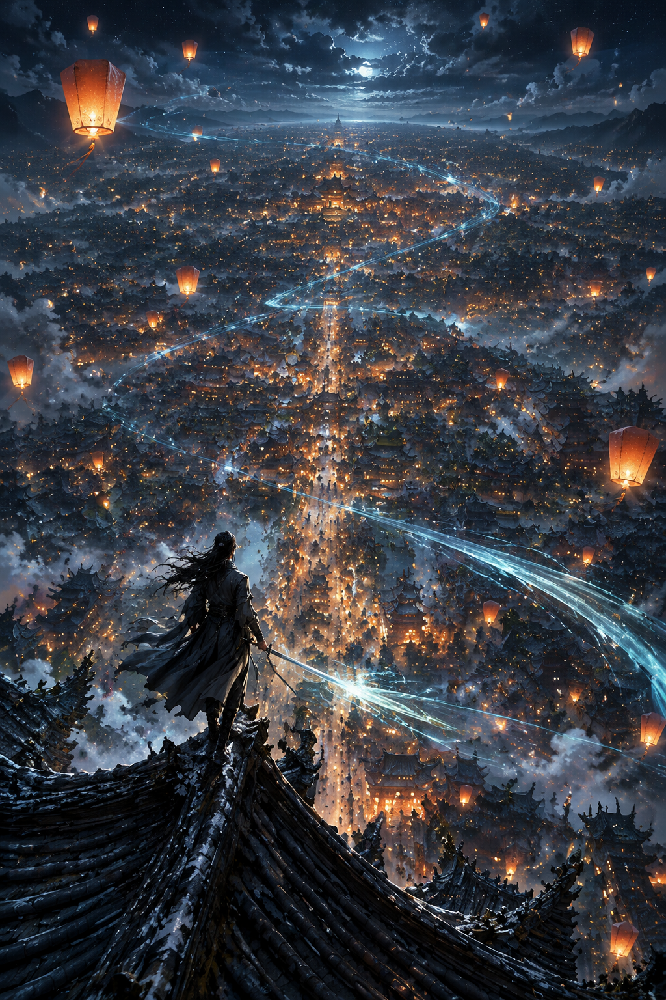 |  | 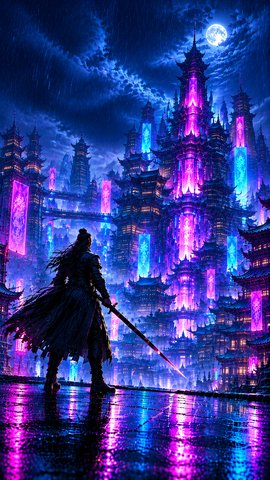 |
| Baseline | **8.96** · 8 轮<br>`7.96 → 8.96` | **9.38** · 8 轮<br>`8.15 → 9.38` | **8.97** · 8 轮<br>`8.38 → 8.97` | **9.60** · 3 轮<br>`9.06 → 9.60` | **9.18** · 8 轮<br>`6.90 → 9.18` |

#### 案例 02 · 粉彩速写少女

| 📥 原图 | 🤖 low | 🤖 medium | 🤖 high | 🎮 recompose | 🔥 大改 |
| :---: | :---: | :---: | :---: | :---: | :---: |
|  | 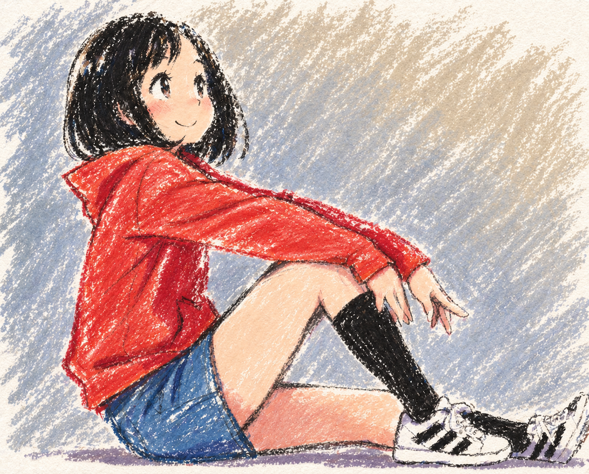 |  | 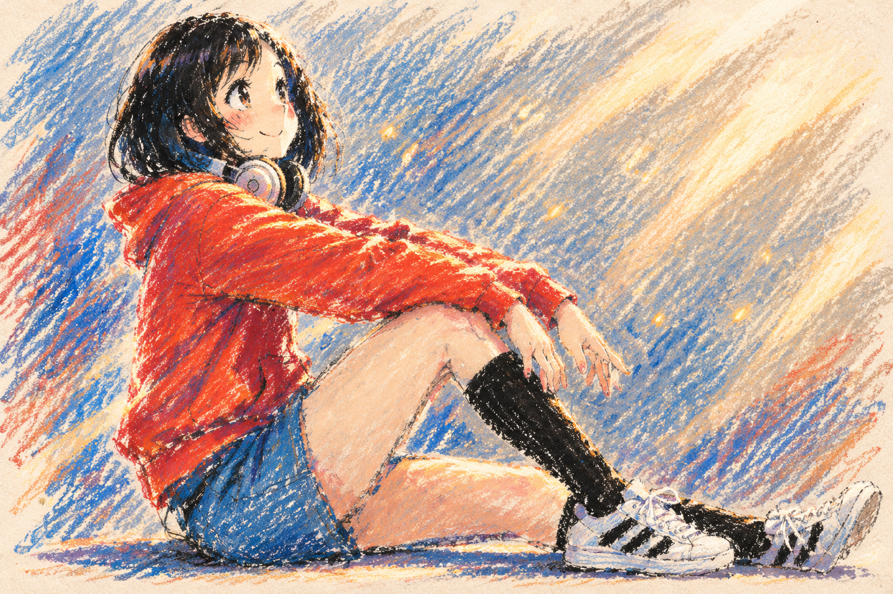 | 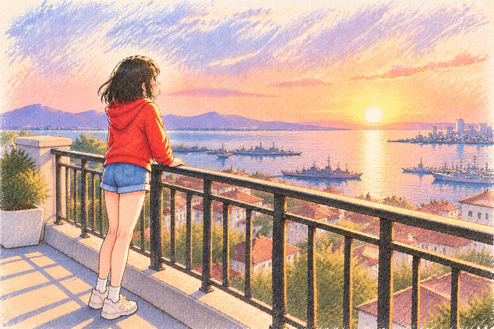 |  |
| Baseline | **8.72** · 8 轮<br>`7.88 → 8.72` | **8.86** · 8 轮<br>`7.99 → 8.86` | **9.35** · 8 轮<br>`9.22 → 9.35` | **9.68** · 6 轮<br>`8.60 → 9.68` | **9.09** · 8 轮<br>`8.10 → 9.09` |

#### 案例 03 · 窗边日光胸像

| 📥 原图 | 🤖 low | 🤖 medium | 🤖 high | 🎮 recompose | 🔥 大改 |
| :---: | :---: | :---: | :---: | :---: | :---: |
|  |  |  | 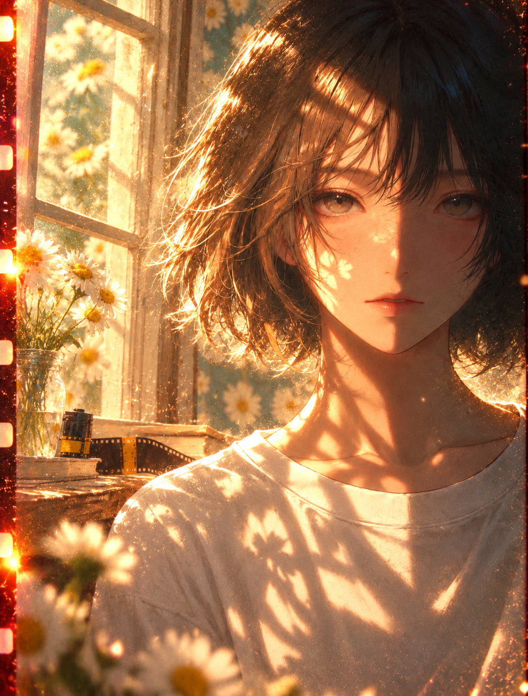 |  |  |
| Baseline · **8.30** | **8.91** · 8 轮<br>`8.91 → 8.91` | **8.81** · 8 轮<br>`8.61 → 8.81` | **9.35** · 8 轮<br>`8.79 → 9.35` | **9.18** · 8 轮<br>`8.21 → 9.18` | **9.66** · 2 轮<br>`8.88 → 9.66` |

#### 案例 04 · 天井峡谷概念

| 📥 原图 | 🤖 low | 🤖 medium | 🤖 high | 🎮 recompose | 🔥 大改 |
| :---: | :---: | :---: | :---: | :---: | :---: |
|  | 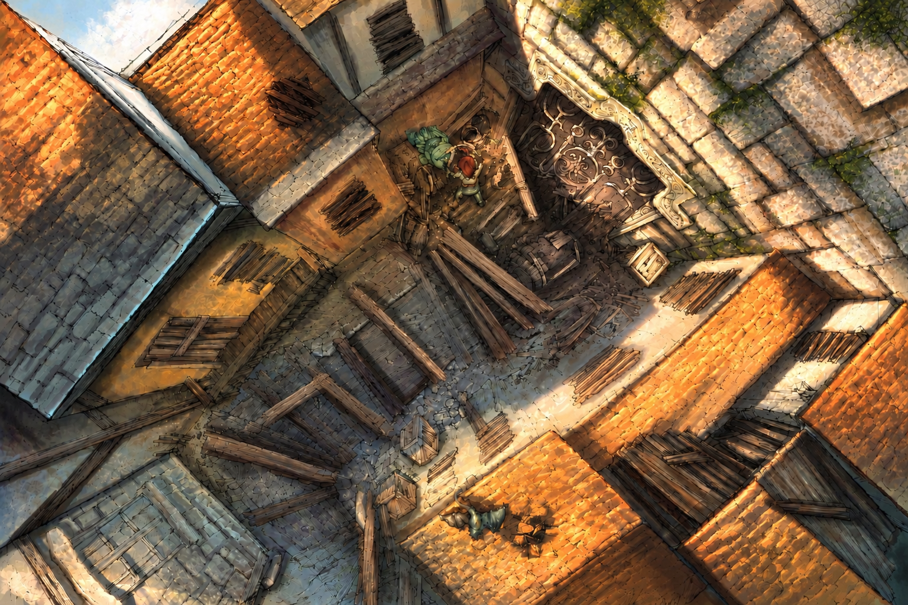 | 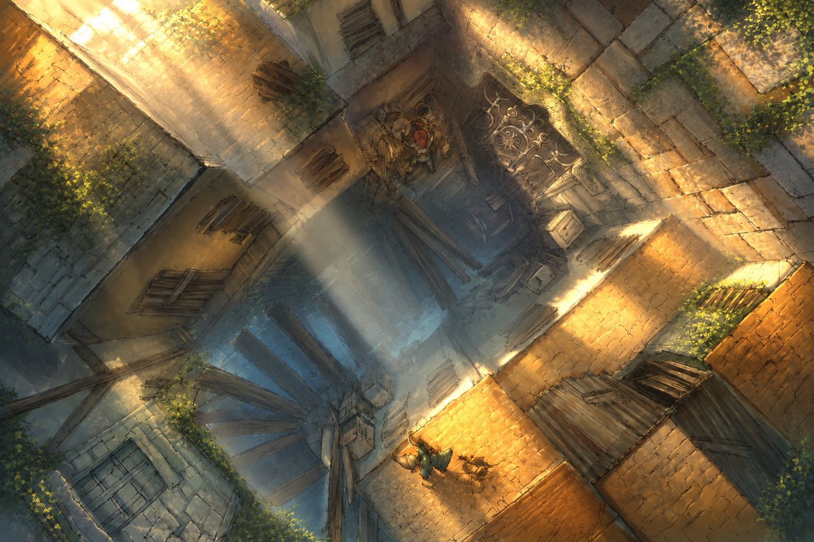 | 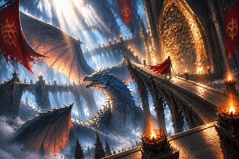 | 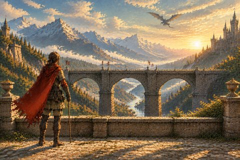 | 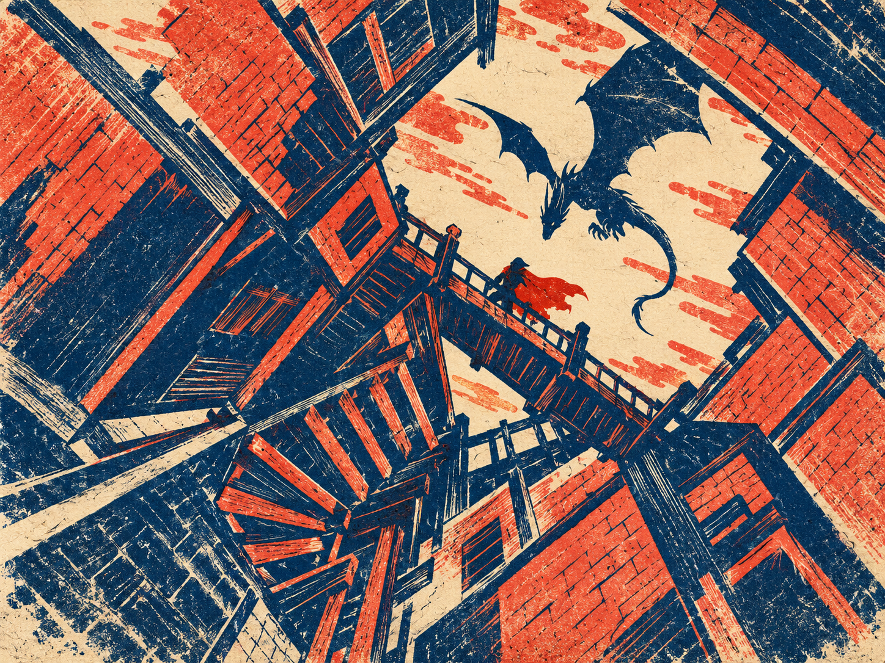 |
| Baseline · **7.06** | **7.97** · 8 轮<br>`7.40 → 7.97` | **8.45** · 8 轮<br>`7.27 → 8.45` | **9.55** · 8 轮<br>`7.96 → 9.55` | **9.70** · 5 轮<br>`→ 9.70` | **9.40** · 8 轮<br>`→ 9.40` |

> 横看：同一原图在 low → medium → high → recompose → 大改 的差异。竖看：R1 到终稿怎么抬分（Absolute-5D Quant）。

### Merge ladder · Clone Mode B（另外两技能实测）

全页展陈（含分数出处）：[docs/showcase/skills-homepage/index.html](docs/showcase/skills-homepage/index.html)

| 技能 | 在测什么 | 稳定性门槛 | 本批结果 |
| :--- | :--- | :--- | :--- |
| **`pmem-merge-ladder`** | 当时按整梯棋盘测过；现行技能是八张正方形、先定关系再抬美术 | 连续 3 个**新域** OK | **MET** · G1/G2/G3 均 8/8（整梯那一轮） |
| 风格克隆（未做成斜杠技能） | Mode B：锁风格 ~95% + **新主体** · REF\|RESULT | 连续 3 组 OK（每组 icon+char+UI） | **MET** · G1→G2→G3 |

#### Merge ladder · 合并进阶梯

Market 风格参考（只锁 medium + 网格，不抄 motif）：

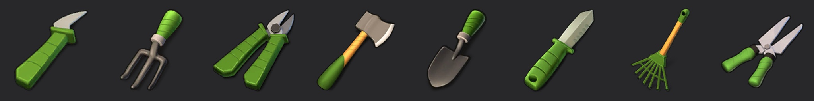

| G1 · 烘焙厨具 | G2 · 清洁工具 | G3 · 运动装备 |
| :---: | :---: | :---: |
| 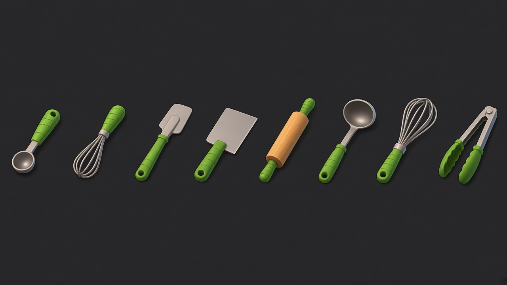 | 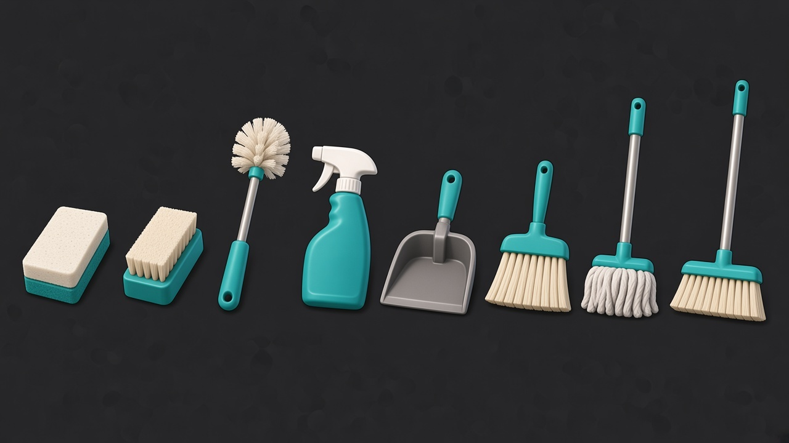 | 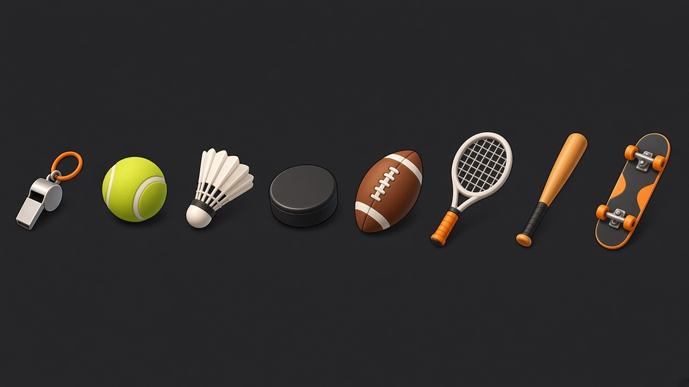 |
| **8/8 ≥9.6** · min cell **9.7** · r01 | **8/8 ≥9.6** · min cell **9.7** · r03 | **8/8 ≥9.6** · min cell **9.7** · r01 |
| 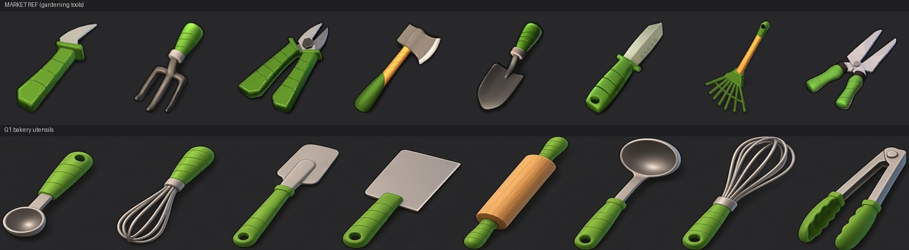 | 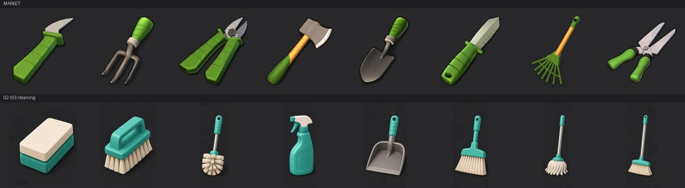 | 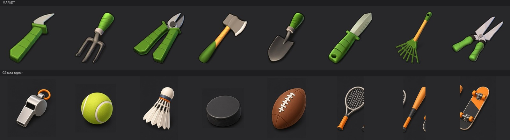 |

额外整梯（清洁八档 · verify2 · 全 PASS）：

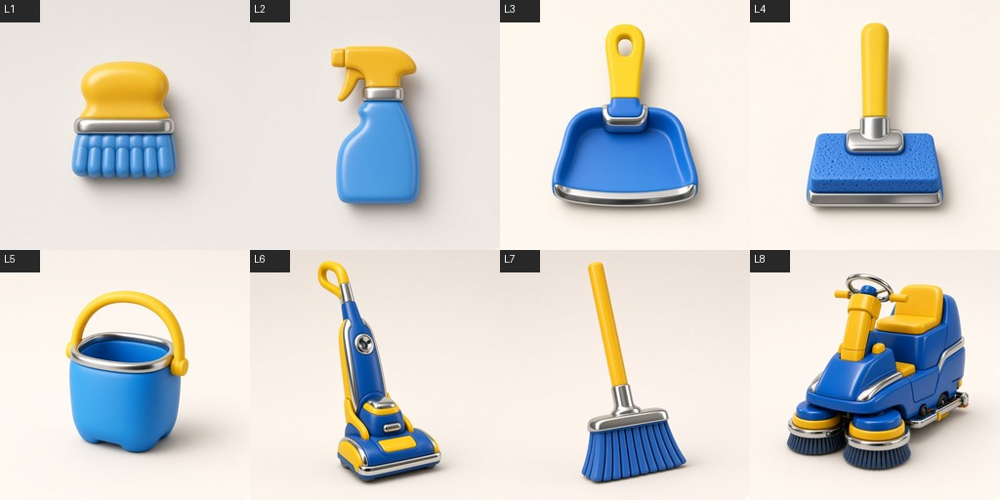

#### Clone Mode B · 风格克隆新主体

G3 连胜终局（icon / char / UI 均 Absolute-5D ≥9.6）：

| ICON · Scroll 9.7 | CHAR · Blacksmith 9.6 | UI · Jackpot 9.6 |
| :---: | :---: | :---: |
| 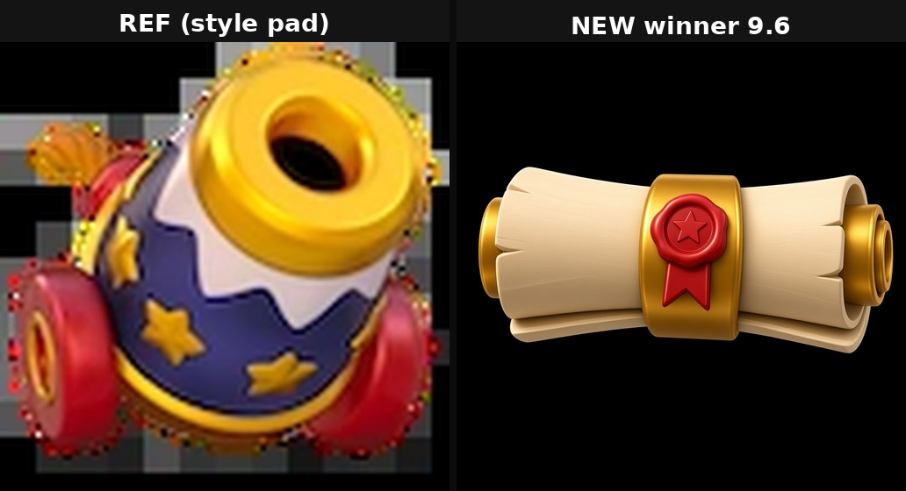 | 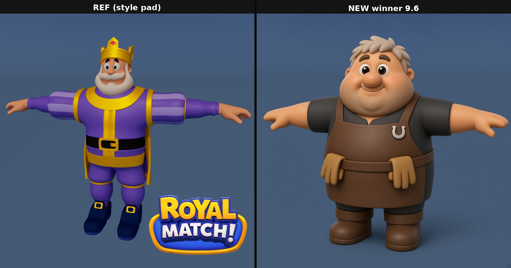 |  |
| cannon booster → 卷轴+蜡封 | king T-pose → 铁匠（空手） | unlock chrome → Jackpot 弹窗 |

同批更早过关（仍计入稳定性循环）：

| ICON · Potion 9.7（G2） | UI · Bonus 9.7（G1） |
| :---: | :---: |
| 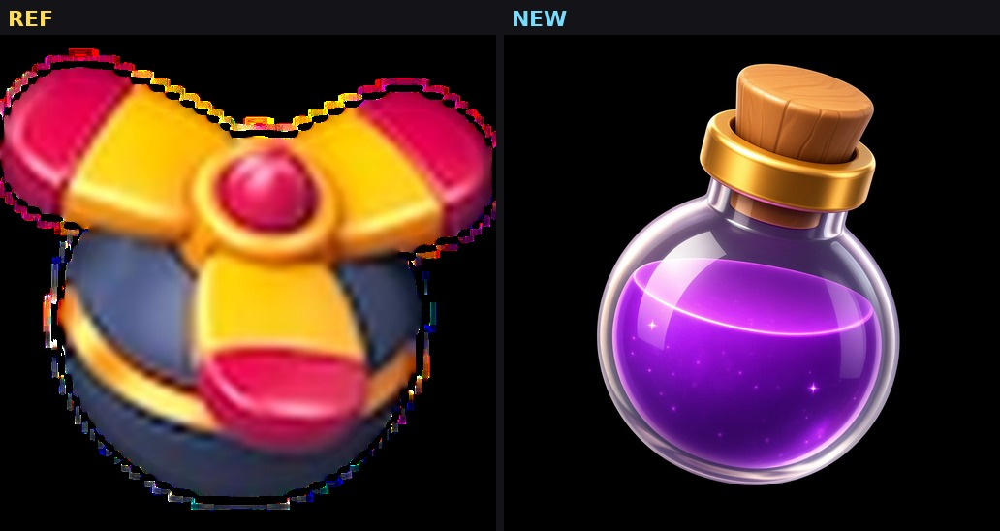 |  |

> 分数均来自真实 `SCORES.md` / `REPORT.md` 跑分，不是展示用编造分。

---

## 记忆是干什么的（简单说）

画师日常不用记命令。Skill 跑完会悄悄把「红线、过稿配方、色板」写进项目里的 `.memory-art/`。

你也可以随口沉淀：

```bash
python3 pmem_art.py feedback "太赛博了，别这样画" -m character.Astra
python3 pmem_art.py feedback "这版留着" -m character.Astra -a path/to/keep.png
```

下次再画同角色 / 同场景，Agent 会先翻这些记录，少重复翻车。细节见 [USER_MANUAL.md](USER_MANUAL.md)。

---

## License

见 [LICENSE](LICENSE)。
