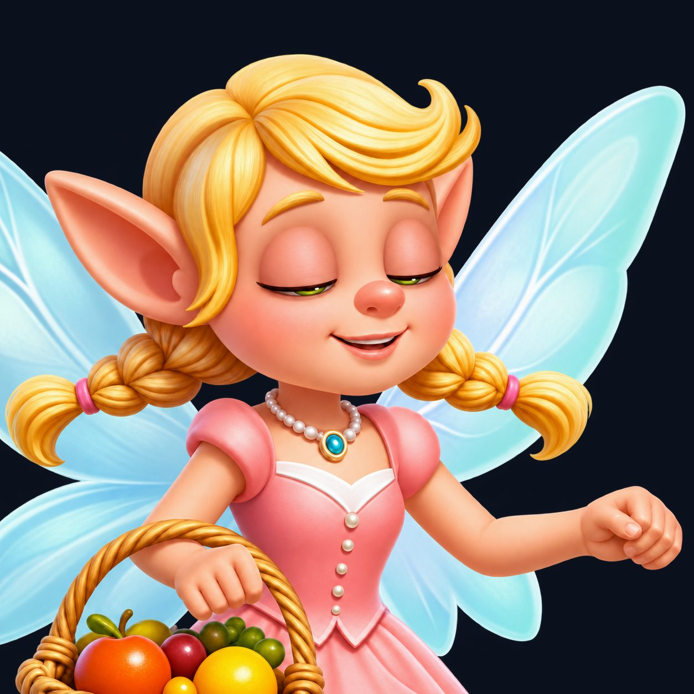
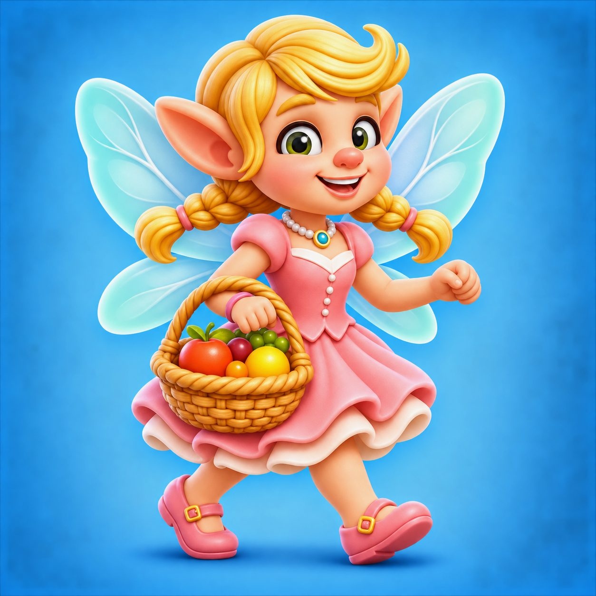
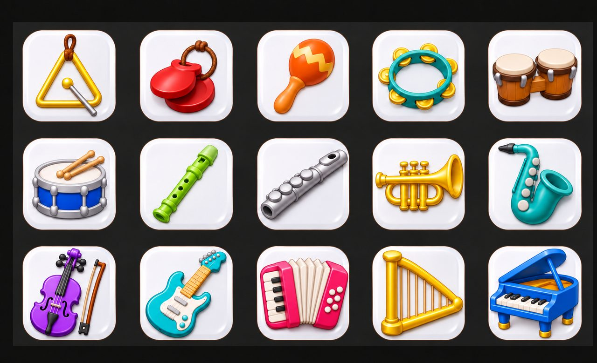
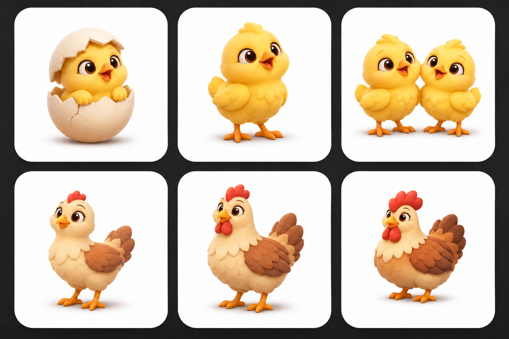

<div align="center">

# pmem-art

**画师的美术记忆系统**（Cursor / Claude Code / Codex）

把「别赛博 / 这版留着」、过稿配方和翻车红线记在这个项目里。下次画同一角色、同一场景，先翻这些记录再出图，画面更稳，少重复犯错。不够分就改，最多 **4 轮**，直到 **≥ 9.50**。

**日常直接说人话就行**（例：`画一张窗边女孩`），不必背技能名、不必敲斜杠。系统会认路；说不清会先问你一句。进阶才需要 `/pmem-…`。


[📦 下载用户包 0.16.4-art](https://github.com/mry-ship/pmem-art/releases/tag/v0.16.4-art) · [📖 使用手册](USER_MANUAL.md) · [认路白话流程图](docs/route_pipeline.html) · [进阶技能点选](docs/skills/flows.html) · [效果图墙](#效果长什么样) · [全页展陈](docs/showcase/skills-homepage/index.html) · [架构](ARCHITECTURE.md)

</div>

---

## 它做什么

目的是美术记忆。你随口说的审美、定过的稿、踩过的坑，都收进项目，后面的图沿着同一条线收敛。

- **记住**：红线、过稿配方、色板、身份锚点写在 `.memory-art/`
- **收敛**：每轮打分挑刺，不到 9.50 只改那一两处，满 4 轮交最高分
- **稳住**：同一张脸不换人，同一套画风不漂，说过不要的不再出现

技能是配套工具。你平时只要大白话提需；总控会认路（见 [认路白话流程图](docs/route_pipeline.html)），只有一种确定情况就直接做，多种情况先问你。原画、克隆、变体、界面、图标、合成梯都不用自己点名——说不清时系统会问一句，不会默默画错。

## 一分钟接入

**推荐画师：下用户包**（不含研发用 pmem）→ [Releases · v0.16.4-art](https://github.com/mry-ship/pmem-art/releases/tag/v0.16.4-art)

```bash
# 解压 pmem-art-0.16.4-art.zip 后
pip install -r requirements.txt
pyw -3 -u pmem_art.py init --name "MyArtProject"
pyw -3 -u pmem_art.py skills --install
```

开发仓克隆：

```bash
git clone https://github.com/mry-ship/pmem-art.git
cd pmem-art
pip install -r requirements.txt
pyw -3 -u pmem_art.py init --name "MyArtProject"
pyw -3 -u pmem_art.py skills --install
```

Runtime: `pillow`, `numpy`, `pyyaml`. Tests: `pytest`（见 `pytest.ini`，`testpaths=tests`）。

装好后，在对话框里**直接说**：`画一张窗边女孩水彩半身`（可附图可无图）。看到 `【走默认路径】` 或 `【按 XX 走了】` 就对了。认路总图：[docs/route_pipeline.html](docs/route_pipeline.html)。

| 场景 | 命令 |
| :--- | :--- |
| 空项目 / 用户包 | `init` → `skills --install` |
| 已有美术目录（不乱移文件） | `bootstrap --mode legacy --roots Art assets` → `accept --all` → `skills --install` |
| 只刷新技能 | `pyw -3 -u pmem_art.py skills --install` |

---

## 日常怎么用（大白话）

```text
1. 直接说人话           把想做的话说完；有参考就拖进来（没有也行）
2. 看最前面的标签       【按 XX 走了】/【走默认路径】/【路由停】先问你一句
3. 若问你就回一句       例如图标选 A/B/C，或补一句「画一张××」
4. 出图                 生 1 张 → 打分挑刺 → 不到 9.50 就改（最多 4 轮）
5. 看过程               结算打开过程板：参考图、每轮图、六维和总分
```

过程板在 `.memory-art/converge/boards/<会话>/index.html`。多张参考图按图1、图2分开列，分析写在图上方。红框是胜出轮。总控这一轮分析，以及合成梯的关系论述，都留在同一张板上。

其余命令还在，直接点也能用。日常不用记，交给 `/pmem-agent` 就行。

合成梯多一步：先用 3 稿把升级链和画风定清楚（这一段不出图），说不通就不出图；默认整表一组出齐（通常 8 档，对标后可改为 6 等合理档数），只有点名逐格才一档一张。白卡内禁超框；生物链要有眼睛。

### 复制即用

```text
/pmem-agent [拖入参考图] 只修五指与透视，不改构图
/pmem-agent [拖入参考图] 保持构图，补侧逆光与材质
/pmem-agent [拖入参考图] 原画：锁画风与身份，升级戏剧光影
/pmem-agent [拖入参考图] 改成运河石拱桥仰视
```

句子里写了「原画」，总控会交给生图里的原画那一支。你不用再输入别的命令。

### 10 个技能

玩家日常只调用 **`/pmem-agent`**。下表其余 9 条是它读过之后会去执行的技能，不用自己点。技能文件一共 **10 个**。

<table>
<thead>
<tr><th></th><th>技能</th><th>输入</th><th>做什么</th></tr>
</thead>
<tbody>
<tr><td>1</td><td>总控</td><td><code>/pmem-agent</code></td><td>以后只走这一条。一轮审核：确定就列出分析并直接执行；多种情况先列出来等确认。另提要求则再审一遍，确认后再执行。可默认的路径/版式/同范围写入分析。单交付交一支；整页对比可依次多支。出图结算仍是那一支的格式。</td></tr>
<tr><td>2</td><td>生图</td><td><code>/pmem-draw</code></td><td>普通图、原画、克隆、变体或镜头包。生图最多 4 轮，合格线 ≥9.5。结算给一张可点开的过程板。有参考但没说新题材时，不进克隆。</td></tr>
<tr><td>3</td><td>界面</td><td><code>/pmem-ui</code></td><td>一整套 HUD / 菜单 / 九宫格。不用单张插画代替。</td></tr>
<tr><td>4</td><td>图标</td><td><code>/pmem-icon</code></td><td>三档不混：A 桌面母版、B 线性 SVG、C 道具格。</td></tr>
<tr><td>5</td><td>合成梯</td><td><code>/pmem-merge-ladder</code></td><td>先用 3 稿定链型/档数/画风（说不通就不出图）；默认整表一组（通常 8 档，对标后跟合理档数）；仅点名逐格才一档一张。商业对标优先；生物链要眼睛；白卡禁超框。论述和出图留在过程板。</td></tr>
<tr><td>6</td><td>提示词</td><td><code>/pmem-prompt</code></td><td>按交付类型扩成 2～4 套可选 brief。不生图，点选后再交给对应技能。</td></tr>
<tr><td>7</td><td>锁风格</td><td><code>/pmem-style-lock</code></td><td>从样张抽色板、光影、禁用词。不进自动生图。</td></tr>
<tr><td>8</td><td>审图</td><td><code>/pmem-critique</code></td><td>只打分挑刺，不生图。</td></tr>
<tr><td>9</td><td>归档</td><td><code>/pmem-atlas</code></td><td>散图归位，刷新看图工作台（见下方「看图工作台」）。</td></tr>
<tr><td>10</td><td>教练</td><td><code>/pmem-coach</code></td><td>进步、短板、知识合在这一条里看。说「进步」或「知识」就看那一份。知识卡要你说收下才写入。</td></tr>
</tbody>
</table>

### 看图工作台（art-atlas）

```bash
pyw -3 -u pmem_art.py atlas
```

终端会打印本机地址（端口按项目自动分配，多开时不会互抢，例如 `http://127.0.0.1:27913/art-atlas.html`）。**请用打印出的 http 链接打开**，或双击根目录「打开工作台.cmd」（不要只双击本地 `art-atlas.html`：`file://` 下删除/定位常被浏览器拦住；也不要假定永远是 27865）。

- 默认只看定稿；过程图请进放大预览的「显示进化过程」
- 删除 = 移入 `.memory-art/_trash/`（可找回）；刷新后不会再把已删图加载回来
- 教学示例图受保护，工作台删不掉

要原画、克隆、变体或镜头包时，仍把类型写在 `/pmem-agent` 的句子里，例如「原画」「按这张风格画一把新钥匙」「换个表情」「先给 4 套机位」。总控会交给对应的那一支。

### `/pmem-agent`：以后只走这一条

`/pmem-agent` 是总控，自己不生图。只审一轮：写出交付物、每张图锁什么、不锁什么，并查合理性、缺漏和理解错误。能默认的（路径、版式、「再跑一遍」同范围等）写成「默认：…」放进分析，不要拿来卡流程。只有一种确定情况，列出分析后直接执行。交付物类型互斥、身份/题材会做错、话与图矛盾这类多种情况，列出来等你确认，确认前不执行。你如果没选列出的情况、而是另提要求，就按新话说再审一遍，仍要等你确认后再执行。

第二段把定稿、每一张图、现有技能文件交给一个 agent。普通单交付选一支；定稿若是整页展陈/对比页，按清单依次点名多支并收新 HTML。回显「按 XX 走了」。出图结算仍是那一支自己的过程板。

<a id="四档闸门每档允许变什么--禁止变什么"></a>

### 四档改动幅度（选错了用嘴改就行）

百分比是这一轮提示词允许改多少。`low` 跟第 1 轮的句子比，另外三档跟上一轮的句子比。四档合格线都是 ≥9.50，生图最多 4 轮。

<table>
<thead>
<tr>
<th>档位</th>
<th>提示词改动</th>
<th>锁住，不能动</th>
<th>可以变</th>
</tr>
</thead>
<tbody>
<tr>
<td><code>low</code><br><small>第 1 轮达标就能停</small></td>
<td>≤ <strong>20%</strong></td>
<td>机位、姿态、主体数量、场景布局、画风色板、身份</td>
<td>局部瑕疵：手、透视毛刺、小边缘、局部质感</td>
</tr>
<tr>
<td><code>medium</code>（默认）<br><small>第 1 轮达标就能停</small></td>
<td>≤ <strong>40%</strong></td>
<td>机位、主体数量、画风色板、身份。不能整张换构图</td>
<td>小幅姿态、局部布局、光影和材质</td>
</tr>
<tr>
<td><code>high</code><br><small>至少跑 2 轮</small></td>
<td>≤ <strong>80%</strong></td>
<td>画风媒介、身份。不能换成另一个主体</td>
<td>机位、姿态、布局、主体数量、戏剧光影、风格里的小叙事</td>
</tr>
<tr>
<td><code>recompose</code><br><small>至少跑 2 轮。必须写 <code>--recompose-dir</code></small></td>
<td>≤ <strong>85%</strong></td>
<td>画风色板、身份、你写的那句构图方向</td>
<td>机位和布局按这句改。姿态和光影可以跟着动。不增删主体</td>
</tr>
</tbody>
</table>

停机线统一：**≥ 9.50**（`high` / `recompose` 至少跑 2 轮），并内置 **5 项安全收敛护栏**：
1. **每轮垫最初参考图**：`low` / `medium` / `high` / `recompose` 每一轮都垫最初的 `style_ref`，修正只追加进提示词。风格跳跃不垫旧风格图，也不垫上一轮成图。`pad=previous` 仍是显式链式覆盖。
2. **解剖 `< 7.5` 一票否决（熔断）**：全局停机仍以加权总分 `≥ 9.50` 为准，仅当 `透视与解剖 < 7.5`（严重肢体/结构崩坏）时强制禁停重修；看板同时展示 `总分≥9.5` 与 `总分≥9.5 且 解剖≥8.5` 双指标。
3. **前 3 轮不因掉分停**：生图上限就是第 4 轮。到第 4 轮时，若连续 2 轮比历史最高分低超过 `0.5`，交历史最高分那张。
4. **按题材触发 R1 结构底线**：仅人物/生物自动注入关节/握持/双瞳高光底线；纯空镜仅注入透视灭点与接触阴影；UI/图标跳过人体解剖词。
5. **精简回流与评分容错**：单轮 `【回流修正】` 硬限 `≤ 2` 条；评分 API 偶发失败自动重试，绝不灌入泛化套话污染下一轮 Prompt。

嫌某档太死或太放：同档直接加一句话，例如「medium：允许更大冷暖对比，仍禁止换机位」。细则 → [手册附录 A](USER_MANUAL.md#附录-a四档---scale-细则与示例)。

---

<a id="效果长什么样"></a>

## 效果长什么样

> **怎么认路、怎么用技能** → [认路白话流程图](docs/route_pipeline.html)（推荐先打开）  
> **全页展陈（话术 + 过程图 + 终稿）** → [docs/showcase/skills-homepage/index.html](docs/showcase/skills-homepage/index.html)  
> 图源：`docs/workbench_guide/`（技能教学样例）+ 最新合成梯整表 · 闭环最多 4 轮 · ≥9.50

### draw · 普通图 / 原画 / 克隆 / 变体

从左到右：原图 → 过程 → 终稿（表头分是终稿总分）。

| 普通图 · 蘑菇芝士果盘 **9.54** | 原画 · 微缩庭院 Key Art **9.50** | 克隆 · 新题材锁画风 **9.52** | 变体 · 同身份改一项 **9.55** |
| :---: | :---: | :---: | :---: |
|  |  |  |  |

| 普通图 · 原图 | 过程 R1 · 9.44 | 终稿 · **9.54** | 多图分工终稿 · **9.55** |
| :---: | :---: | :---: | :---: |
|  |  |  |  |

### 界面 · 图标 · 锁风格

| 三消 HUD · **9.55** | 图标 A 桌面母版 · **9.55** | 图标 C 道具格 · **9.55** | 锁风格卡 |
| :---: | :---: | :---: | :---: |
|  |  |  |  |

### 合成梯 · 整表一组（默认）

乐器 5×3 整表（垫海船版式）终稿 **9.55**；鸟类轻门 2×3（破壳→下蛋母鸡，档数跟合理=6）。

| 乐器合成梯 · 终稿 | 鸟类 Chickens · L1–L6 整表 |
| :---: | :---: |
|  |  |

完整话术与过程轮次 → [全页展陈](docs/showcase/skills-homepage/index.html)。认路思路 → [route_pipeline.html](docs/route_pipeline.html)。

---

## 记忆是干什么的（简单说）

画师日常不用记命令。Skill 跑完会悄悄把「红线、过稿配方、色板」写进项目里的 `.memory-art/`。

你也可以随口沉淀：

```bash
pyw -3 -u pmem_art.py feedback "太赛博了，别这样画" -m character.Astra
pyw -3 -u pmem_art.py feedback "这版留着" -m character.Astra -a path/to/keep.png
```

下次再画同角色 / 同场景，Agent 会先翻这些记录，少重复翻车。细节见 [USER_MANUAL.md](USER_MANUAL.md)。

---

## License

见 [LICENSE](LICENSE)。
