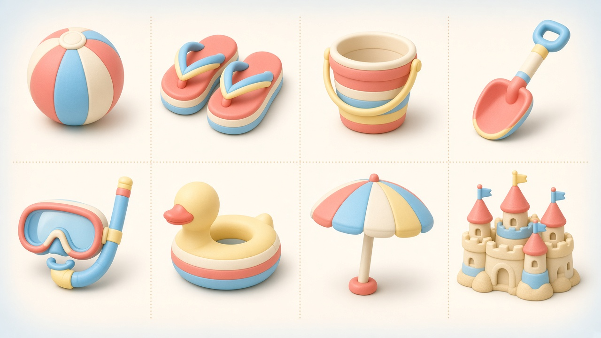
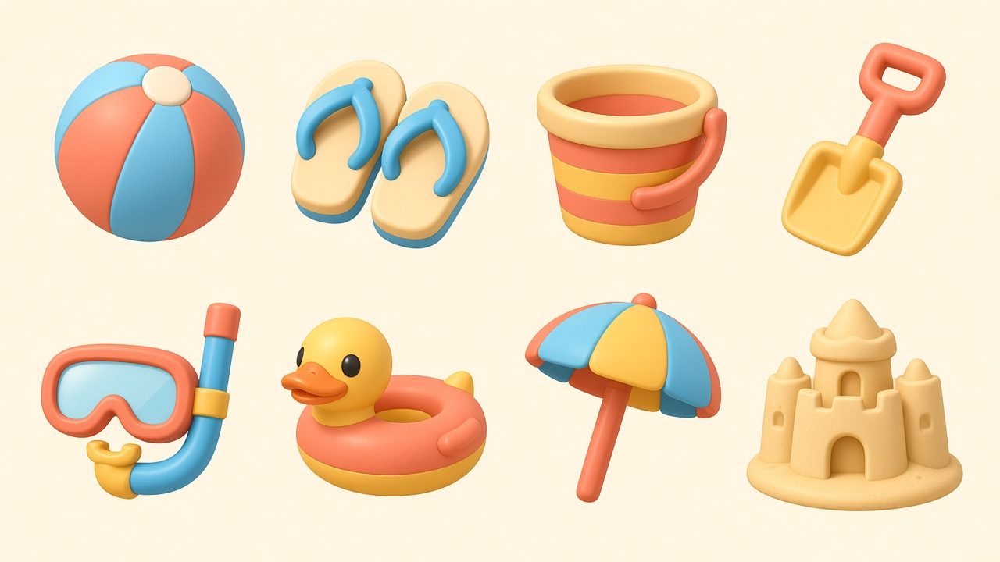
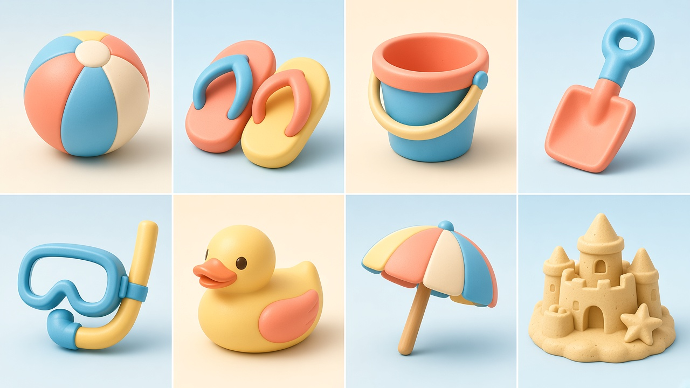
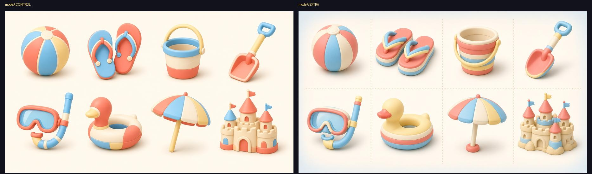
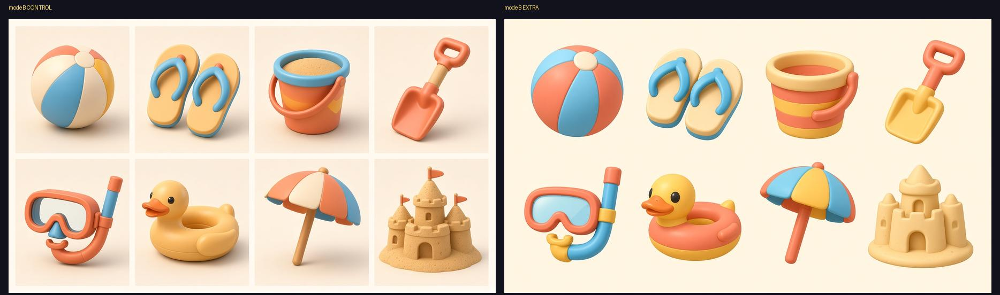
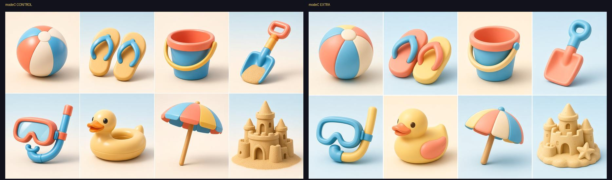
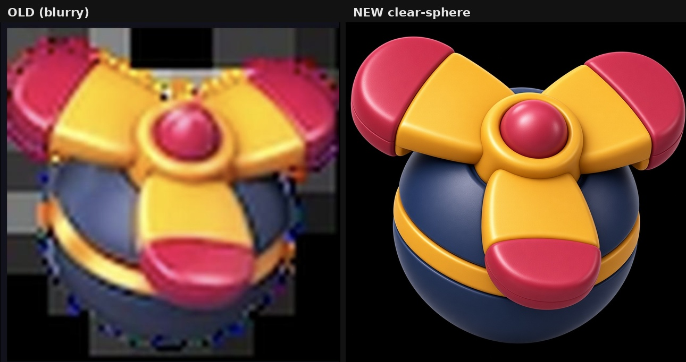
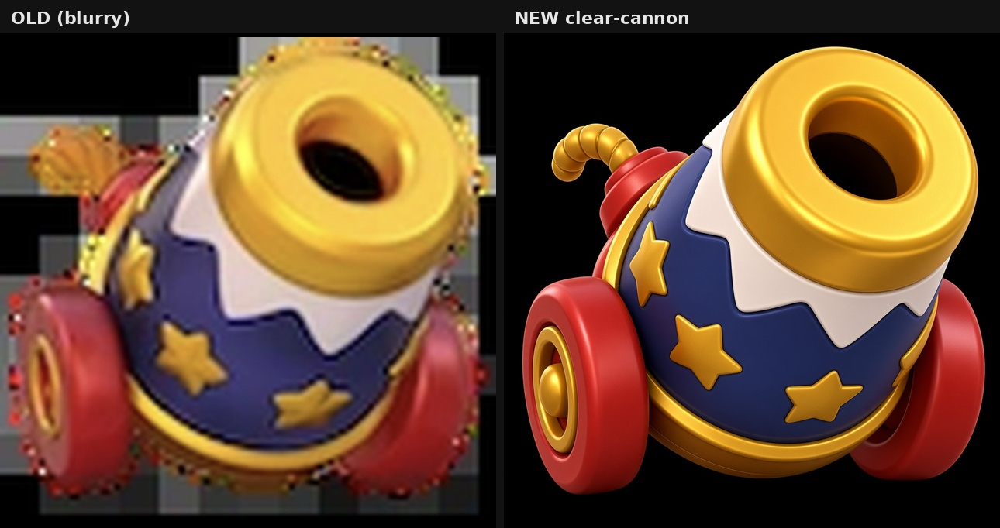

<div align="center">

# pmem-art

**画师的美术记忆系统**（Cursor / Claude Code / Codex）

把「别赛博 / 这版留着」、过稿配方和翻车红线记在这个项目里。下次画同一角色、同一场景，先翻这些记录再出图，画面更稳，少重复犯错。不够分就改，最多 **4 轮**，直到 **≥ 9.60**。

常用技能就这几个，都是 `/pmem-` 开头：

`/pmem-agent` 总控 · `/pmem-draw` 生图 · `/pmem-ui` 整套界面 · `/pmem-icon` 图标 · `/pmem-merge-ladder` 合成梯


[📖 使用手册](USER_MANUAL.md) · [技能流程图](docs/skills/flows.html) · [效果图墙](#效果长什么样) · [合成梯 / 克隆实测](#合成梯与风格克隆旧跑分) · [架构](ARCHITECTURE.md)

</div>

---

## 它做什么

目的是美术记忆。你随口说的审美、定过的稿、踩过的坑，都收进项目，后面的图沿着同一条线收敛。

- **记住**：红线、过稿配方、色板、身份锚点写在 `.memory-art/`
- **收敛**：每轮打分挑刺，不到 9.60 只改那一两处，满 4 轮交最高分
- **稳住**：同一张脸不换人，同一套画风不漂，说过不要的不再出现

技能是配套工具。没点名具体技能时走 `/pmem-agent`：先把需求定稳，再交给合适的那一支。原画、克隆、变体都在 `/pmem-draw` 里，界面、图标、合成梯各有自己的一条。

## 一分钟接入

```bash
git clone https://github.com/mry-ship/pmem-art.git
cd pmem-art
python3 pmem_art.py init --name "MyArtProject"
python3 pmem_art.py skills --install
```

装好后，在 Cursor / Claude Code / Codex 对话框输入 `/`。技能一共 **9 个**，每个只有一个 `/pmem-` 名字，见下一节。没点名时用 `/pmem-agent`。

| 场景 | 命令 |
| :--- | :--- |
| 空项目 | `init` → `skills --install` |
| 已有美术目录（不乱移文件） | `bootstrap --mode legacy --roots Art assets` → `accept --all` → `skills --install` |
| 只刷新技能 | `python3 pmem_art.py skills --install` |

---

## 日常怎么用（Skill）

```text
1. 没点名技能     走 /pmem-agent。固定 2 轮，第 2 轮查合理性、缺漏和理解错误；还不确定就打回，不生图
2. 丢图（可选）   参考图全部留下。交出去之前不收成一张
3. 选档           --scale low | medium | high | recompose
4. 出图           生 1 张 → 打分挑刺 → 不到 9.60 就改（最多 4 轮）
5. 看过程         结算打开过程板：每张参考图、每轮图、五维和总分，点图片看大图
```

过程板在 `.memory-art/converge/boards/<会话>/index.html`。多张参考图按图1、图2分开列，分析写在图上方。红框是胜出轮。总控把需求收成同一句的那几轮，以及合成梯的关系论述，都留在同一张板上。

点名了某一条，就跳过总控，直接走那一条。

合成梯多一步：先用 3 稿把八件升级链和画风定清楚（这一段不出图），说不通就不出图，通过后再按上面的 4 轮出图。同框大图只是体量预览。

### 复制即用

```text
/pmem-draw --scale low [拖入参考图] 只修五指与透视，不改构图
/pmem-draw --scale medium [拖入参考图] 保持构图，补侧逆光与材质
/pmem-draw --scale high [拖入参考图] 原画：锁画风与身份，升级戏剧光影
/pmem-draw --scale recompose --recompose-dir "改为运河石拱桥仰视" [拖入参考图]
```

第三行写了「原画」，`/pmem-draw` 会按原画做，不用另开一个命令。

### 9 个技能

技能文件是 **9 个**，下表正好 **9 行**。没点名具体技能时走总控。点名了某一条，就直接走那一条。

<table>
<thead>
<tr><th></th><th>技能</th><th>输入</th><th>做什么</th></tr>
</thead>
<tbody>
<tr><td>1</td><td>总控</td><td><code>/pmem-agent</code></td><td>没点名具体技能时走这一条。多轮把需求定稳，再把定稿和每一张图交给现有技能。出图结算仍是那一支的格式：参考分析、每轮图和分数、过程板、总结。满 4 轮还定不稳，就打回问你，不往下生图。</td></tr>
<tr><td>2</td><td>生图</td><td><code>/pmem-draw</code></td><td>普通图、原画、克隆、变体或镜头包。生图最多 4 轮，合格线 ≥9.6。结算给一张可点开的过程板。有参考但没说新题材时，不进克隆。</td></tr>
<tr><td>3</td><td>界面</td><td><code>/pmem-ui</code></td><td>一整套 HUD / 菜单 / 九宫格。不用单张插画代替。</td></tr>
<tr><td>4</td><td>图标</td><td><code>/pmem-icon</code></td><td>三档不混：A 桌面母版、B 线性 SVG、C 道具格。</td></tr>
<tr><td>5</td><td>合成梯</td><td><code>/pmem-merge-ladder</code></td><td>先用 3 稿把升级链和画风定清楚（说不通就不出图），再一档一张正方形。同框只是体量预览。出图最多 4 轮。论述和出图轮都留在过程板上。</td></tr>
<tr><td>6</td><td>锁风格</td><td><code>/pmem-style-lock</code></td><td>从样张抽色板、光影、禁用词。不进自动生图。</td></tr>
<tr><td>7</td><td>审图</td><td><code>/pmem-critique</code></td><td>只打分挑刺，不生图。</td></tr>
<tr><td>8</td><td>归档</td><td><code>/pmem-atlas</code></td><td>散图归位，刷新 <code>art-atlas.html</code>。</td></tr>
<tr><td>9</td><td>教练</td><td><code>/pmem-coach</code></td><td>进步、短板、知识合在这一条里看。说「进步」或「知识」就看那一份。知识卡要你说收下才写入。</td></tr>
</tbody>
</table>

要原画、克隆、变体或镜头包时，还是用 `/pmem-draw`，把类型写在句子里，例如「原画」「按这张风格画一把新钥匙」「换个表情」「先给 4 套机位」。

### 没点名时

`/pmem-agent` 自己不生图。固定 2 轮：第 1 轮写出交付物、每张图锁什么、不锁什么；第 2 轮查合理性、缺漏和理解错误。第 2 轮没有「还不确定」，并且话和图对得上，这句就是定稿。还有写不清的地方，就打回，一次只问还晃的那一处。

第二段把定稿、每一张图、现有技能文件交给一个 agent。由它读现稿选一支并执行。回显一句「按 XX 走了」。出图结算仍是那一支自己的过程板。

<a id="四档闸门每档允许变什么--禁止变什么"></a>

### 四档改动幅度（选错了用嘴改就行）

百分比是这一轮提示词允许改多少。`low` 跟第 1 轮的句子比，另外三档跟上一轮的句子比。四档合格线都是 ≥9.60，生图最多 4 轮。

<table>
<thead>
<tr>
<th>档位</th>
<th>提示词改动</th>
<th>锁住，不能动</th>
<th>可以变</th>
</tr>
</thead>
<tbody>
<tr>
<td><code>low</code><br><small>第 1 轮达标就能停</small></td>
<td>≤ <strong>20%</strong></td>
<td>机位、姿态、主体数量、场景布局、画风色板、身份</td>
<td>局部瑕疵：手、透视毛刺、小边缘、局部质感</td>
</tr>
<tr>
<td><code>medium</code>（默认）<br><small>第 1 轮达标就能停</small></td>
<td>≤ <strong>40%</strong></td>
<td>机位、主体数量、画风色板、身份。不能整张换构图</td>
<td>小幅姿态、局部布局、光影和材质</td>
</tr>
<tr>
<td><code>high</code><br><small>至少跑 2 轮</small></td>
<td>≤ <strong>80%</strong></td>
<td>画风媒介、身份。不能换成另一个主体</td>
<td>机位、姿态、布局、主体数量、戏剧光影、风格里的小叙事</td>
</tr>
<tr>
<td><code>recompose</code><br><small>至少跑 2 轮。必须写 <code>--recompose-dir</code></small></td>
<td>≤ <strong>85%</strong></td>
<td>画风色板、身份、你写的那句构图方向</td>
<td>机位和布局按这句改。姿态和光影可以跟着动。不增删主体</td>
</tr>
</tbody>
</table>

停机线统一：**≥ 9.60**（`high` / `recompose` 至少跑 2 轮），并内置 **5 项安全收敛护栏**：
1. **每轮垫最初参考图**：`low` / `medium` / `high` / `recompose` 每一轮都垫最初的 `style_ref`，修正只追加进提示词。风格跳跃不垫旧风格图，也不垫上一轮成图。`pad=previous` 仍是显式链式覆盖。
2. **解剖 `< 7.5` 一票否决（熔断）**：全局停机仍以加权总分 `≥ 9.60` 为准，仅当 `透视与解剖 < 7.5`（严重肢体/结构崩坏）时强制禁停重修；看板同时展示 `总分≥9.6` 与 `总分≥9.6 且 解剖≥8.5` 双指标。
3. **前 3 轮不因掉分停**：生图上限就是第 4 轮。到第 4 轮时，若连续 2 轮比历史最高分低超过 `0.5`，交历史最高分那张。
4. **按题材触发 R1 结构底线**：仅人物/生物自动注入关节/握持/双瞳高光底线；纯空镜仅注入透视灭点与接触阴影；UI/图标跳过人体解剖词。
5. **精简回流与评分容错**：单轮 `【回流修正】` 硬限 `≤ 2` 条；评分 API 偶发失败自动重试，绝不灌入泛化套话污染下一轮 Prompt。

嫌某档太死或太放：同档直接加一句话，例如「medium：允许更大冷暖对比，仍禁止换机位」。细则 → [手册附录 A](USER_MANUAL.md#附录-a四档---scale-细则与示例)。

---

## 效果长什么样

### 自我进化总览


### V8 · 20 Bot（skills_kit · Absolute-5D）

4 案例 ×（原画 / low / medium / high / recompose / 大改）= **20 终图**。这批是旧上限跑的（当时最多 8 轮、停分 ≥9.60）。现在生图上限是 **最多 4 轮**；表里的「8 轮」只说明那一格实际跑了几轮。  
本批均值 **9.14**（≥9.60 达标 **4/20**）。全页：[docs/showcase/pmem_art_images_v8_20bots_showcase.html](docs/showcase/pmem_art_images_v8_20bots_showcase.html)

Grok 三轮优化 best-of（离线 Absolute-5D 均值 **8.504**）：[docs/showcase/grok_best/pmem_art_images_v8_20bots_grok_best_showcase.html](docs/showcase/grok_best/pmem_art_images_v8_20bots_grok_best_showcase.html) · 永久策略与三轮结论：[docs/grok_v8_3round/FINAL_3ROUND_SYNTHESIS_AND_POLICY.md](docs/grok_v8_3round/FINAL_3ROUND_SYNTHESIS_AND_POLICY.md)

#### 案例 01 · 仙侠不夜城

| 📥 原图 | 🤖 low | 🤖 medium | 🤖 high | 🎮 recompose | 🔥 大改 |
| :---: | :---: | :---: | :---: | :---: | :---: |
|  |  |  |  |  |  |
| Baseline | **8.96** · 8 轮<br>`7.96 → 8.96` | **9.38** · 8 轮<br>`8.15 → 9.38` | **8.97** · 8 轮<br>`8.38 → 8.97` | **9.60** · 3 轮<br>`9.06 → 9.60` | **9.18** · 8 轮<br>`6.90 → 9.18` |

#### 案例 02 · 粉彩速写少女

| 📥 原图 | 🤖 low | 🤖 medium | 🤖 high | 🎮 recompose | 🔥 大改 |
| :---: | :---: | :---: | :---: | :---: | :---: |
|  |  |  |  |  |  |
| Baseline | **8.72** · 8 轮<br>`7.88 → 8.72` | **8.86** · 8 轮<br>`7.99 → 8.86` | **9.35** · 8 轮<br>`9.22 → 9.35` | **9.68** · 6 轮<br>`8.60 → 9.68` | **9.09** · 8 轮<br>`8.10 → 9.09` |

#### 案例 03 · 窗边日光胸像

| 📥 原图 | 🤖 low | 🤖 medium | 🤖 high | 🎮 recompose | 🔥 大改 |
| :---: | :---: | :---: | :---: | :---: | :---: |
|  |  |  |  |  |  |
| Baseline · **8.30** | **8.91** · 8 轮<br>`8.91 → 8.91` | **8.81** · 8 轮<br>`8.61 → 8.81` | **9.35** · 8 轮<br>`8.79 → 9.35` | **9.18** · 8 轮<br>`8.21 → 9.18` | **9.66** · 2 轮<br>`8.88 → 9.66` |

#### 案例 04 · 天井峡谷概念

| 📥 原图 | 🤖 low | 🤖 medium | 🤖 high | 🎮 recompose | 🔥 大改 |
| :---: | :---: | :---: | :---: | :---: | :---: |
|  |  |  |  |  |  |
| Baseline · **7.06** | **7.97** · 8 轮<br>`7.40 → 7.97` | **8.45** · 8 轮<br>`7.27 → 8.45` | **9.55** · 8 轮<br>`7.96 → 9.55` | **9.70** · 5 轮<br>`→ 9.70` | **9.40** · 8 轮<br>`→ 9.40` |

> 横看：同一原图在 low → medium → high → recompose → 大改 的差异。竖看：R1 到终稿怎么抬分（Absolute-5D Quant）。

### 合成梯与风格克隆（旧跑分）

全页展陈（V8×20 + Merge/Clone，含分数出处）：[docs/showcase/skills-homepage/index.html](docs/showcase/skills-homepage/index.html)

| 技能 | 在测什么 | 稳定性门槛 | 本批结果 |
| :--- | :--- | :--- | :--- |
| **`pmem-merge-ladder`** | Mode A/B/C 同域 beach-candy 整梯；另有早期 Mode C 三新域连胜 | 八格每一格 Absolute-5D ≥9.6 | **A PASS** min 9.8 · **B/C FAIL**（L6 脸红线）· 早期 G1–G3 MET |
| 风格克隆 | Mode B：锁风格 ~95% + **新主体** · REF\|RESULT。现在在 `/pmem-draw` 里说「按这个风格画新题材」 | 连续 3 组 OK（每组 icon+char+UI） | **MET** · G1→G2→G3 |

#### Merge ladder · Mode A / B / C（beach-candy）

同源 beach-candy 八格梯 · EXTRA 片（相对 CONTROL 更优或同级）。分数见 [`modes-abc/SCORES.md`](docs/showcase/skills-homepage/assets/merge/modes-abc/SCORES.md)。

| Mode A · 零参考 | Mode B · 单参考垫 | Mode C · 参考整梯+新域 |
| :---: | :---: | :---: |
|  |  |  |
| **min 9.8 PASS** · beach-candy · 零参考 | **min 8.8 FAIL** · beach-candy · 单参考垫<br>（L6 鸭子黑点脸） | **min 8.5 FAIL** · beach-candy · 参考整梯+新域<br>（同 L6 脸红线） |
|  |  |  |

#### Merge ladder · 早期 Mode C 稳定性连胜（G1 / G2 / G3）

较早一轮：连续 3 个**新域** category-swap 均 8/8 ≥9.6（整梯棋盘）。

| G1 · 烘焙厨具 | G2 · 清洁工具 | G3 · 运动装备 |
| :---: | :---: | :---: |
|  |  |  |
| **8/8 ≥9.6** · min cell **9.6** · r02 | **8/8 ≥9.6** · min cell **9.8** · r02 | **8/8 ≥9.6** · min cell **9.7** · r01 |
|  |  |  |

#### Clone Mode B · 风格克隆新主体

G3 连胜终局（icon / char / UI 均 Absolute-5D ≥9.6）：

| ICON · Scroll 9.6 | CHAR · Blacksmith 9.6 | UI · Jackpot 9.6 |
| :---: | :---: | :---: |
|  |  |  |
| cannon booster → 卷轴+蜡封 | king T-pose → 铁匠（空手） | unlock chrome → Jackpot 弹窗 |

同批更早过关（仍计入稳定性循环）：

| ICON · Potion 9.6（G2） | UI · Bonus 9.6（G1） |
| :---: | :---: |
|  |  |

清晰重出 · same subject（Mode B 垫糊图清出，Absolute-5D ≥9.6）：

| ICON · 球械 9.64 | ICON · 玩具炮 9.62 |
| :---: | :---: |
|  |  |
| 糊图垫 → 清晰球械 | 糊图垫 → 清晰玩具炮 |

> 分数均来自真实 `SCORES.md` / `REPORT.md` 跑分，不是展示用编造分。

---

## 记忆是干什么的（简单说）

画师日常不用记命令。Skill 跑完会悄悄把「红线、过稿配方、色板」写进项目里的 `.memory-art/`。

你也可以随口沉淀：

```bash
python3 pmem_art.py feedback "太赛博了，别这样画" -m character.Astra
python3 pmem_art.py feedback "这版留着" -m character.Astra -a path/to/keep.png
```

下次再画同角色 / 同场景，Agent 会先翻这些记录，少重复翻车。细节见 [USER_MANUAL.md](USER_MANUAL.md)。

---

## License

见 [LICENSE](LICENSE)。
